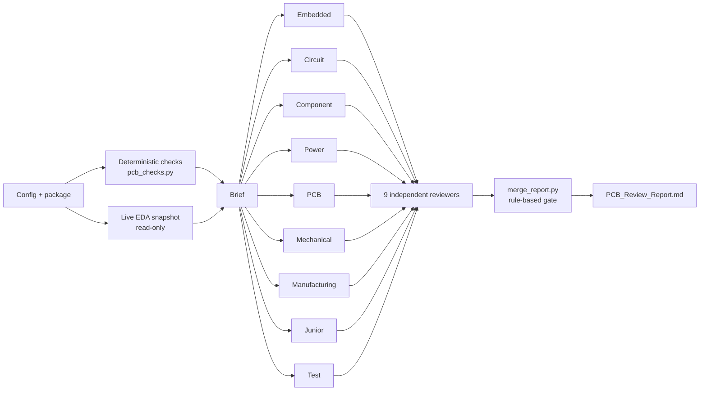

# PCB Review Team

**A role-based hardware design review for [Claude Code](https://claude.com/claude-code).** Nine AI engineers each review your PCB project from their own discipline. Every one of them is checked by an independent reviewer. Deterministic scripts screen the release package, and a rule-based gate decides whether the design is ready for human sign-off.

It is built for the moment before you send a board to fab, or before a design review where someone will question every choice.

```
/pcb-review            full review: 9 disciplines + 9 independent reviews
/pcb-review quick      PCB, circuit, power, manufacturing
/pcb-review only=pcb,power
/pcb-review interview  likely reviewer/interviewer questions, grounded answers, weak spots
```

## The team

| Discipline | Agent | Looks at |
|---|---|---|
| Hardware Lead | the `/pcb-review` skill | Orchestrates, collects evidence, writes the brief, runs the gate, integrates the report |
| Senior Embedded Engineer | `hw-senior-embedded-engineer` | Requirements trace, interfaces, logic levels, bus addressing, power-up states, firmware, multi-board system context |
| Circuit Engineer | `hw-circuit-engineer` | Pin-level schematic vs datasheets and vendor reference designs, connector pin 1 through cables |
| Component Engineer | `hw-component-engineer` | Ratings and derating, MLCC DC bias, lifecycle, stock, second sources |
| Power Engineer | `hw-power-engineer` | Power budget, contact derating, copper/via capacity, decoupling, converter loops, inrush |
| Senior PCB Design Engineer | `hw-senior-pcb-design-engineer` | Stack-up, recomputed impedance, diff pairs *as implemented*, return paths, IPC-2221B HV spacing, DRC coverage |
| Mechanical Integration Engineer | `hw-mechanical-engineer` | Envelope, holes, height stack, connector insertion, flex bend radius (IPC-2223), 3D completeness |
| Manufacturing Engineer | `hw-manufacturing-engineer` | DFM/DFA, fab drawing and notes, output freshness, assembler data; triages every automatic-check failure |
| Junior PCB Engineer | `hw-junior-pcb-engineer` | Footprints vs land patterns, and every number in the documents vs the real design data |
| HW Test Engineer | `hw-test-engineer` | Test matrix, safe bring-up, probe access, link verification, fault isolation |
| Independent Reviewer | `hw-independent-reviewer` | One fresh instance per discipline: re-derives each finding's evidence → confirm / refute / re-grade, finds misses |

## How a review runs



1. **Evidence first.** `pcb_checks.py` screens the release package: Gerber layer set, outline size, empty files, minimum copper draw width, the drill table against the fab profile, BOM integrity (quantity vs designators, duplicates, missing part numbers), pick-and-place bounds, BOM ↔ CPL agreement, DRC report totals, and whether outputs are **older than the last CAD save**. The Lead also takes one read-only snapshot from the EDA tool, so every reviewer works from the same data. For Altium, `eda_snapshot.py` talks MCP to [eda-agent](https://github.com/salitronic/eda-agent), calls only an allowlist of read-only tools and writes the results straight to disk. For KiCad, it uses `kicad-cli`.
2. **A shared brief:** requirements (R1..Rn), decisions, house rules, interfaces, the fab profile, file and evidence indexes, and which files are confidential.
3. **Parallel discipline reviews.** Each engineer works through its checklist and must account for every item (finding, checked OK, or not checked with a reason). Every finding needs evidence: a datasheet page, a measurement, a recomputed calculation, a document section or a standard clause.
4. **Independent review.** A separate agent with a fresh context, which did not write the findings, tries to refute each one. It re-opens the datasheet, re-runs the calculation, re-reads the measurement, flags skipped checklist items and adds what was missed.
5. **A deterministic gate** (`merge_report.py`):
   - **BLOCKED**: any CRITICAL that wasn't refuted.
   - **CONDITIONAL**: any MAJOR, or an untriaged automatic-check FAIL.
   - **READY_FOR_SIGNOFF**: otherwise.
   The model can't talk its way past the gate, and the tool never "approves". A human signs off.
6. **Integrated report:** top issues, decisions the designer must make, scorecard, refuted findings (so you can see what was thrown out and why), open hand-offs and limitations.

## Install

Requirements: Claude Code and Python 3.9+. Optional:
- [eda-agent](https://github.com/salitronic/eda-agent) for live Altium data, or `kicad-cli` for KiCad;
- `pypdf` (installed by `--with-pdf`) to turn large PDFs (standards, guides, long specs) into text for the reviewers.

```bash
git clone https://github.com/<you>/pcb-review-team
python pcb-review-team/install.py --project path/to/your/project --with-pdf
```

This copies `.claude/agents/hw-*.md` and `.claude/skills/pcb-review/` into your project and creates `pcb-review.config.json`. Use `--user` instead to install for all projects. It adds no hooks and doesn't touch `settings.json`.

Then start a new Claude Code session in the project (agents load at session start) and run:

```
/pcb-review setup     # fills in pcb-review.config.json with you
/pcb-review quick     # first run
```

Add the `output_dir` (default `pcb-review/`) to your project's `.gitignore` if it holds confidential material.

## Configuration (`pcb-review.config.json`)

| Key | Meaning |
|---|---|
| `project_name`, `product_context` | What the board is and the system it lives in. Reviewers judge severity against this. |
| `package_dir`, `cad_dirs` | Release package to screen; master CAD folder(s) for the freshness and copy-mismatch checks |
| `eda` | `altium-eda-agent`, `kicad` or `none` |
| `copper_layers`, `fab_profile` | Expected layer count; a profile in `skills/pcb-review/profiles/` (JLCPCB included; add your fab) |
| `requirements_sources`, `design_docs`, `decisions_log`, `reference_design`, `interfaces` | What the design must meet and why it is the way it is |
| `datasheets_dir`, `reference_guides` | Local datasheets (checked first) and design guides the reviewers may cite |
| `house_rules` | Your standards (schematic style, routing style...), reviewed like requirements |
| `confidential` | Files that may be read locally but must never go to web searches or external services |
| `python`, `pdf_python` | Interpreters for the scripts |

## Outputs

```
pcb-review/2026-10-19_1430_full/
  brief.md                    shared brief
  evidence/auto_checks.md     deterministic package checks (+ .json)
  evidence/live/*.json        read-only EDA snapshot
  findings/<discipline>.json  + .md   each engineer's findings
  verdicts/<discipline>.json          each independent reviewer's verdicts
  summary.md, merged.json     gate + scorecard (deterministic)
  PCB_Review_Report.md        the integrated report
```

To waive a finding, add `waivers.json` (`[{"id": "PCB-004", "by": "name", "reason": "..."}]`) and run `/pcb-review merge <run_dir>`.

## Standalone scripts

The scripts are useful without Claude too:

```bash
python .claude/skills/pcb-review/scripts/pcb_checks.py package --package release/ --out out/ \
       --profile .claude/skills/pcb-review/profiles/jlcpcb_standard.json --layers 4 --cad cad/
python .claude/skills/pcb-review/scripts/pcb_calc.py diff-microstrip --w 0.13 --s 0.13 --h 0.1 --t 0.035 --er 4.1
python .claude/skills/pcb-review/scripts/pcb_calc.py spacing --volts 70        # IPC-2221B Table 6-1
python .claude/skills/pcb-review/scripts/pcb_calc.py contacts --load 1.2 --rating 0.5 --derate 0.7
python .claude/skills/pcb-review/scripts/eda_snapshot.py --out snap/ --mcp-json .mcp.json --server eda-agent   # read-only Altium snapshot
```

`pcb_calc.py` covers IPC-2141 microstrip/stripline (single and differential), IPC-2221 trace current and width, connector contact counts with derating, IPC-2221B spacing, length-to-skew and copper weight.

## Safety and privacy
- **Read-only.** Reviewers never modify design files, and the Lead never calls EDA tools that modify, save, sync, autoroute or run a modal DRC.
- **The designer decides.** Findings that involve an engineering choice are marked `needs_designer_decision` and list the options; no agent picks for you.
- **Confidential stays local.** Files listed as confidential are never sent to web searches or external services.
- **Not a certification.** LLM reviewers can be wrong; the independent review and the evidence rule reduce that, but don't remove it. No SI/PI simulation is performed. Use it as a rigorous second opinion, then sign off yourself.

## Extending
Add a discipline in three steps:
1. Write `checklists/<key>.md`.
2. Add an agent file following the existing ones.
3. Add the key to the team table in `SKILL.md`.

Add a fab by dropping a JSON file into `profiles/`.

## Tests
```bash
python -m unittest discover -s tests -v
```

## Credits
Ideas, not code, drawn from:
- [ktanino10/ai-hardware-engineering-team](https://github.com/ktanino10/ai-hardware-engineering-team): discipline roles, each with an independent reviewer, and the "evidence or UNKNOWN" rule.
- [Keitark/pcba-design-skills](https://github.com/Keitark/pcba-design-skills): gated workflows.

The checklists cite public references, which are not included: Sierra Circuits' *High-Speed PCB Design Guide* (2020), TI application report SZZA009 *PCB Design Guidelines for Reduced EMI*, and the IPC standards they name.

## License
MIT. See [LICENSE](LICENSE).
